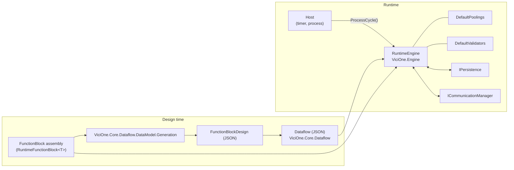

# ViciOne Engine

[](https://gitlab.com/vicione-oss/vicione/runtime/engine/-/pipelines)
[](https://dotnet.microsoft.com/)
[](LICENSE.txt)

ViciOne Engine is the dataflow runtime of the [ViciOne](https://gitlab.com/vicione-oss) platform. It contains everything needed to describe a **dataflow** – a graph of **FunctionBlocks** connected by **links** – and to execute it deterministically in discrete **cycles**.

FunctionBlocks are plain .NET classes. Their metadata is generated from the compiled assembly, so the code stays the single source of truth. The engine takes care of value propagation, type conversion, aggregation of values from multiple sources, validation, persistence and external communication, while the host decides when a cycle runs.

In production, dataflows are not hosted directly on this engine: [Managed Engine](https://gitlab.com/vicione-oss/vicione/runtime/managed-engine) builds on it and adds communication providers, persistence backends and dynamic assembly loading, and [Engine Host](https://gitlab.com/vicione-oss/vicione/runtime/engine-host) deploys and runs any number of managed engines in a shared cycle.

## Contents

- [Features](#features)
- [Concepts](#concepts)
- [Architecture](#architecture)
- [Packages](#packages)
- [Getting started](#getting-started)
  - [Prerequisites](#prerequisites)
  - [1. Write a FunctionBlock](#1-write-a-functionblock)
  - [2. Generate the FunctionBlock design](#2-generate-the-functionblock-design)
  - [3. Try the block interactively](#3-try-the-block-interactively)
  - [4. Host the engine](#4-host-the-engine)
- [Configuration](#configuration)
- [Observability](#observability)
- [Command-line tools](#command-line-tools)
- [Samples](#samples)
- [Building from source](#building-from-source)
- [Repository layout](#repository-layout)
- [Versioning and changelog](#versioning-and-changelog)
- [Contributing](#contributing)
- [Related projects](#related-projects)
- [License](#license)

## Features

- **FunctionBlocks as plain C# classes** – derive from `RuntimeFunctionBlock<TSelf>`, declare connectors, settings and persistent variables with attributes, and implement `ProcessCycle`.
- **Design generation from assemblies** – the `FunctionBlockDesign` (IDs, connectors, settings, run modes, poolings, validators, defaults) is derived by reflection from the compiled block, so the code stays the single source of truth.
- **Deterministic cycle model** – the host drives the engine one cycle at a time; each cycle propagates changed values, applies settings and invokes exactly the blocks that are due.
- **Run modes** – blocks run on change (`RunMode.Change`) or every *n*-th cycle (`RunMode.Cyclic`).
- **Pooling** – queueing and aggregation of values from one or many sources per link and per connector, with a set of ready-made aggregations (`Min`, `Max`, `Sum`, `Average`, `Concat`, `And`, `Or`, `Xor`, …).
- **Validation** – range, equality, enumeration, regex and string length validators for connectors and settings, combinable per element.
- **Automatic type conversion** – between compatible data types, including date/time types and derived/base types.
- **Drivers** – share hardware access or long-running background work between blocks.
- **Persistence hooks** – plug in your own storage for settings and persistent variables via `IPersistence`.
- **External communication** – connect dataflows across engines or to other systems via `ICommunicationManager` and external links.
- **Bounded memory** – configurable capacities for receive buffers and link queues; dropped entries are logged and counted.
- **Built-in telemetry** – tracing and metrics based on `System.Diagnostics`, ready for OpenTelemetry.
- **Unloadable block assemblies** – designed for loading blocks into collectible `AssemblyLoadContext`s.
- **Cross-platform** – runs on Windows and Linux (`win-x64`, `linux-x64`, `linux-arm64`).

## Concepts

| Term | Meaning |
|-|-|
| **Dataflow** | The graph that one engine executes: FunctionBlocks in (nested) containers plus the links between them. Serializable to JSON. |
| **FunctionBlock (FB)** | A unit of logic with input connectors, output connectors, settings and persistent variables. |
| **FunctionBlock design** | The metadata describing a block type. Generated from the block's assembly. |
| **Connector** | A typed input or output of a block. Carries a value, a validity and a changed flag. |
| **Link** | Connects an output connector to an input connector. *External* links connect to other engines or systems. |
| **Setting** | A configuration value of a block. Can be persisted and changed at runtime. |
| **Persistent variable** | Internal block state that survives restarts via the attached persistence layer. |
| **Pooling** | How values arriving at an input are combined: queued per link, concatenated, or aggregated per source and across sources. |
| **Validator** | Checks a connector or setting value and rejects invalid ones. |
| **Driver** | A shared component owned by the engine that blocks can use, e.g. for hardware access. |
| **Cycle** | One pass over the dataflow, triggered by the host calling `RuntimeEngine.ProcessCycle()`. |

## Architecture



## Packages

All libraries target **.NET 10** and are published as NuGet packages.

| Package | Description |
|-|-|
| `ViciOne.Core.Contracts` | Contracts of the core objects (data model and runtime) and fundamental types used throughout the code base. |
| `ViciOne.Core.Dataflow` | Objects that represent a dataflow and its components, including editors to build and modify them. |
| `ViciOne.Core.Dataflow.DataModel.Generation` | Analyzer and generator that creates `FunctionBlockDesign`s from a FunctionBlock assembly. |
| `ViciOne.Core.Runtime` | `RuntimeFunctionBlock<TSelf>`, drivers and the attributes used to declare a block. **Reference this to write blocks.** |
| `ViciOne.Core.Runtime.Execution` | Executes the blocks of a single assembly in isolation, e.g. for testing. |
| `ViciOne.Engine` | The runtime engine that executes dataflows. |
| `ViciOne.Engine.DefaultPoolings` | Default aggregation algorithms (`And`, `Or`, `Xor`, `Nand`, `Nor`, `Xnor`, `Min`, `Max`, `Sum`, `Average`, `Concat`). |
| `ViciOne.Engine.DefaultValidators` | Default validators (`Range`, `Equality`, `Inequality`, `Enum`, `Regex`, `StringLength`). |
| `ViciOne.Serialization.Json` | (De-)serialization of dataflows and designs in JSON. |
| `FunctionBlockDesignGenerator` | .NET tool that wraps `ViciOne.Core.Dataflow.DataModel.Generation`. |
| `FunctionBlockExecutor` | .NET tool that wraps `ViciOne.Core.Runtime.Execution`. |

## Getting started

### Prerequisites

- [.NET 10 SDK](https://dotnet.microsoft.com/download/dotnet/10.0)
- An IDE of your choice (Visual Studio 2026, Rider or VS Code with C# Dev Kit)

### 1. Write a FunctionBlock

A block is a `partial class` split into two files: the `*.Designer.cs` file declares the *shape* (connectors, settings, poolings, validators), the other file contains the *behavior*. Reference `ViciOne.Core.Runtime` and, with `PrivateAssets="all"`, the [`ViciOne.Core.Runtime.Analyzers`](https://gitlab.com/vicione-oss/vicione/libs/analyzers) to catch common mistakes at build time.

The quickest way to start is the `vofb` project template from [Engine Templates](https://gitlab.com/vicione-oss/addons/templates/engine-templates), which also provides Visual Studio code snippets for connectors, settings and persistent variables:

```bash
dotnet new install ViciOne.Templates
```

```bash
dotnet new vofb -n Numeric.Add -ns Numeric -bn Add
```

A FunctionBlock that adds two numbers looks like this:

```csharp
// Add.Designer.cs
using ViciOne.Core.Contracts.Runtime;
using ViciOne.Core.Runtime;
using ViciOne.Core.Runtime.Attributes;

namespace Numeric;

[FunctionBlockDesign("bc97fbdb-6023-42b9-917a-1dd11c4eb86a", "f0aa4c9d-ade5-4c6d-aa8f-ffd5c00e593b", "84bc13d4-441a-4366-a9fc-853a2a01ab83")]
public partial class Add : RuntimeFunctionBlock<Add>
{
    public new Inputs_ ProcessDataInputs { get; } = new Inputs_();
    [InputConnectorDesigns]
    public class Inputs_
    {
        [InputConnectorDesign("4ac33ded-2b51-46e8-a393-63033ee6144b")]
        public IRuntimeConnector<double> Addend1 { get; internal set; }
        [InputConnectorDesign("2ec52c92-1ed2-4dc0-98f6-a420aecbbec0")]
        public IRuntimeConnector<double> Addend2 { get; internal set; }
    }

    public new Outputs_ ProcessDataOutputs { get; } = new Outputs_();
    [OutputConnectorDesigns]
    public class Outputs_
    {
        [OutputConnectorDesign("2590dc44-a34c-4796-9768-3f992a231f15")]
        public IRuntimeConnector<double> Sum { get; internal set; }
    }
}
```

```csharp
// Add.cs
using ViciOne.Core.Contracts.Runtime;

namespace Numeric;

public partial class Add
{
    private void CalculateAndPublish()
        => SetConnectorValueIfNotEqual(ProcessDataOutputs.Sum, ProcessDataInputs.Addend1.Value + ProcessDataInputs.Addend2.Value);

    protected override void OnFunctionBlockEnabledChanged()
    {
        base.OnFunctionBlockEnabledChanged();
        if (FunctionBlockEnabled)
            CalculateAndPublish();
    }

    protected override void ProcessCycle(IFunctionBlockCycleInfo cycleInfo)
    {
        if (FunctionBlockEnabled == false)
            return;

        if (ProcessDataInputs.Addend1.Changed || ProcessDataInputs.Addend2.Changed)
            CalculateAndPublish();
    }
}
```

> [!IMPORTANT]
> `ProcessCycle` runs on the engine's cycle and must return quickly. Move blocking or long-running work to a background worker or a driver, and release everything you acquire in `Dispose` so the block assembly can be unloaded. The [`writing-function-blocks`](.claude/skills/writing-function-blocks/SKILL.md) guide covers the lifecycle, run modes, change tracking and unload safety in detail.

### 2. Generate the FunctionBlock design

Build the block project, then generate the JSON designs from the assembly:

```bash
FunctionBlockDesignGenerator --input ./bin/Release/net10.0/Numeric.Add.dll --output ./designs
```

Use `--paths` to point the generator to directories with additional assemblies, e.g. custom poolings or validators. Each design is written to `<Namespace>.<Name>.json` and can be used to build a dataflow with the editors in `ViciOne.Core.Dataflow`.

### 3. Try the block interactively

`FunctionBlockExecutor` loads a block assembly, creates a dataflow for it and lets you step through cycles in the console – change inputs, settings and persistent variables and watch the outputs:

```bash
FunctionBlockExecutor ./bin/Release/net10.0/Numeric.Add.dll
```

To do the same from code, e.g. in unit tests, use `ViciOne.Core.Runtime.Execution.FunctionBlockExecutor`.

### 4. Host the engine

The engine has no built-in clock: the host decides when a cycle runs by calling `ProcessCycle()`.

```csharp
using Microsoft.Extensions.Logging;
using System.Reflection;
using System.Runtime.Loader;
using ViciOne.Core.Contracts;
using ViciOne.Core.Contracts.DataModel;
using ViciOne.Core.Contracts.Runtime;
using ViciOne.Core.Dataflow.DataModel;
using ViciOne.Engine;
using ViciOne.Serialization.Json;

Assembly[] assemblies = [.. Directory.GetFiles("fb-dlls", "*.dll", SearchOption.AllDirectories)
    .Select(AssemblyLoadContext.Default.LoadFromAssemblyPath)];
IDataflow dataflow = JsonSerialization.Default.LoadFromFile<Dataflow>("dataflow.json");
IUniqueNameProvider uniqueNameProvider = new DefaultUniqueNameProvider(NameGenerator.CreateUniqueNames(dataflow));

using ILoggerFactory loggerFactory = LoggerFactory.Create(builder => builder.AddSimpleConsole());
using var engine = new RuntimeEngine(
    dataflow,
    loggerFactory,
    driverAssemblies: assemblies,
    functionBlockAssemblies: assemblies,
    uniqueNameProvider);

engine.Start();

using var timer = new PeriodicTimer(TimeSpan.FromMilliseconds(100));
while (engine.State != EngineState.Stopped && await timer.WaitForNextTickAsync())
    engine.ProcessCycle();
```

Optionally pass implementations of `IPersistence` (for settings and persistent variables) and `ICommunicationManager` (for external links) to the constructor. [`samples/runtime/RuntimeDemo`](samples/runtime/RuntimeDemo) shows a complete host including persistence, communication and value transfer interceptors.

## Configuration

`EngineQueueOptions` bounds the memory the engine uses for values that are waiting to be processed. When a buffer or queue is full, the entry is dropped, a warning is logged and a metric is recorded.

| Option | Default | Description |
|-|-|-|
| `CommunicationReceiveBufferCapacity` | `1,000,000` | Entries received from the communication manager that have not yet been processed. |
| `PerLinkQueueCapacity` | `1,000` | Entries queued per link. |
| `CrossSourceQueueCapacityPerLink` | `100` | Entries queued across sources, per connected link. |

```csharp
var engine = new RuntimeEngine(dataflow, loggerFactory, assemblies, assemblies, uniqueNameProvider,
    queueOptions: new EngineQueueOptions { PerLinkQueueCapacity = 10_000 });
```

## Observability

The engine emits traces and metrics through `System.Diagnostics.ActivitySource` and `System.Diagnostics.Metrics.Meter`, both named `ViciOne.Engine` (see `EngineTelemetry.ActivitySourceName` and `EngineTelemetry.MeterName`). With OpenTelemetry:

```csharp
builder.Services.AddOpenTelemetry()
    .WithTracing(tracing => tracing.AddSource(EngineTelemetry.ActivitySourceName))
    .WithMetrics(metrics => metrics.AddMeter(EngineTelemetry.MeterName));
```

Logging uses `Microsoft.Extensions.Logging`; log messages of blocks and drivers are written to their own categories.

## Command-line tools

| Tool | Usage |
|-|-|
| `FunctionBlockDesignGenerator` | `FunctionBlockDesignGenerator -i <assembly> -o <output-directory> [-p <additional-assembly-directories>...]` |
| `FunctionBlockExecutor` | `FunctionBlockExecutor <assembly>`, then use `Enter` (next cycle), `I` (change input), `S` (change setting), `P` (change persistent variable), `Q` (quit) |

Both are packaged as .NET tools and can be installed with `dotnet tool install`.

## Samples

| Sample | Description |
|-|-|
| [`samples/runtime/fbs`](samples/runtime/fbs) | Sample FunctionBlocks: `Logic.AND`, `Numeric.Add`, `Numeric.Incrementor`, `Demo.SettingsDemo` (settings), `Demo.DriverDemo` (drivers), `Demo.ComplexTypeDemo` (complex types and custom poolings). |
| [`samples/design-time/GenerateFBDesigns`](samples/design-time/GenerateFBDesigns) | Analyzes compiled FunctionBlocks and generates their designs. |
| [`samples/runtime/RuntimeDemo`](samples/runtime/RuntimeDemo) | Hosts an engine with file-based persistence, file-based communication and connector value transfer interceptors. |
| [`samples/runtime/ScaleUpSample`](samples/runtime/ScaleUpSample) | Runs any number of engines on a configurable number of timers to demonstrate scalability. |

The samples expect their input in the `artifacts` folder (see the `launchSettings.json` of each sample), e.g.:

```bash
dotnet run --project samples/runtime/ScaleUpSample -- artifacts/dataflow1.json artifacts/fb-dlls 500 128
```

## Building from source

```bash
git clone https://gitlab.com/vicione-oss/vicione/runtime/engine.git
cd engine
dotnet build "ViciOne Core.slnx" -c Release
```

> [!NOTE]
> The repository's `NuGet.Config` points to ViciOne's package feeds. If they are not reachable from your environment, restore against nuget.org with your own configuration, e.g. `dotnet restore --configfile <your-nuget.config>`.

The build is strict: warnings are treated as errors, code style is enforced via `.editorconfig`, package versions are managed centrally in `Directory.Packages.props`, and restores are locked with `packages.lock.json` (locked mode on CI).

### Tests

```bash
dotnet test "ViciOne Core.slnx" -c Release -s tests.runsettings
```

Tests use [xUnit](https://xunit.net/), [AwesomeAssertions](https://awesomeassertions.org/) and [NSubstitute](https://nsubstitute.github.io/). On Windows, `Coverage.bat` runs the tests and produces an HTML coverage report in `artifacts/tests` using [ReportGenerator](https://github.com/danielpalme/ReportGenerator).

### Benchmarks

Performance-sensitive code is covered by [BenchmarkDotNet](https://benchmarkdotnet.org/) benchmarks:

```bash
dotnet run -c Release --project benchmarks/ViciOne.Engine.Benchmarks
```

Further benchmarks live in `benchmarks/ViciOne.Core.Dataflow.Benchmarks` and `benchmarks/ViciOne.Engine.DefaultPoolings.Benchmarks`.

## Repository layout

```text
├── benchmarks/          BenchmarkDotNet projects
├── samples/
│   ├── design-time/     Design generation sample
│   └── runtime/         Engine hosts and sample FunctionBlocks
├── shared/              Code shared between projects
├── src/                 Libraries and command-line tools
├── tests/               Unit and integration tests
├── CHANGELOG.md         Release notes
├── Directory.Build.props
├── Directory.Packages.props
├── VERSION              Version of all packages
└── ViciOne Core.slnx
```

## Versioning and changelog

All packages share one version, defined in the [`VERSION`](VERSION) file, and follow [Semantic Versioning](https://semver.org/). Notable changes are documented in [`CHANGELOG.md`](CHANGELOG.md), structured like [Keep a Changelog](https://keepachangelog.com/).

## Contributing

Contributions are welcome! Please:

1. Open an [issue](https://gitlab.com/vicione-oss/vicione/runtime/engine/-/issues) to discuss larger changes before you start.
2. Fork the repository and create a branch from `master`.
3. Make sure the solution builds without warnings and all tests pass.
4. Add tests for new behavior and benchmarks for performance-relevant changes.
5. Add an entry to the `Unreleased` section of [`CHANGELOG.md`](CHANGELOG.md).
6. Open a merge request.

## Related projects

| Project | Description |
|-|-|
| [Managed Engine](https://gitlab.com/vicione-oss/vicione/runtime/managed-engine) | Orchestration layer on top of this engine: communication providers, persistence backends, dynamic assembly loading and a mediator pipeline. |
| [Engine Host](https://gitlab.com/vicione-oss/vicione/runtime/engine-host) | Hosting service that deploys, starts and stops managed engines remotely via MQTT and runs them in a shared cycle. |
| [Analyzers](https://gitlab.com/vicione-oss/vicione/libs/analyzers) | `ViciOne.Core.Runtime.Analyzers`: Roslyn analyzers that catch common mistakes when writing FunctionBlocks. |
| [Engine Templates](https://gitlab.com/vicione-oss/addons/templates/engine-templates) | `dotnet new` project templates (`vofb`, `vofb-sample`) and Visual Studio code snippets for developing FunctionBlocks. |
| [Basic FunctionBlocks](https://gitlab.com/vicione-oss/vicione/runtime-libs/basic-functionblocks) | Ready-to-use FunctionBlocks for logic, math, conversion, flow control and time. |
| [FunctionBlock CodeGenerator](https://gitlab.com/vicione-oss/vicione/runtime-libs/fb-generator) | Generates FunctionBlocks from device descriptions such as EtherCAT ESI or Modbus definitions. |
| [AssemblyLoadContext Extensions](https://gitlab.com/vicione-oss/vicione/libs/assemblyloadcontext-extensions) | Detects collectible `AssemblyLoadContext` leaks, e.g. FunctionBlocks that prevent unloading. |

## License

ViciOne Engine is licensed under the [MIT License](LICENSE.txt). Copyright © ViciOne open automation gmbh.

Third-party components and their licenses are listed in [`THIRD-PARTY-NOTICES.md`](THIRD-PARTY-NOTICES.md).
