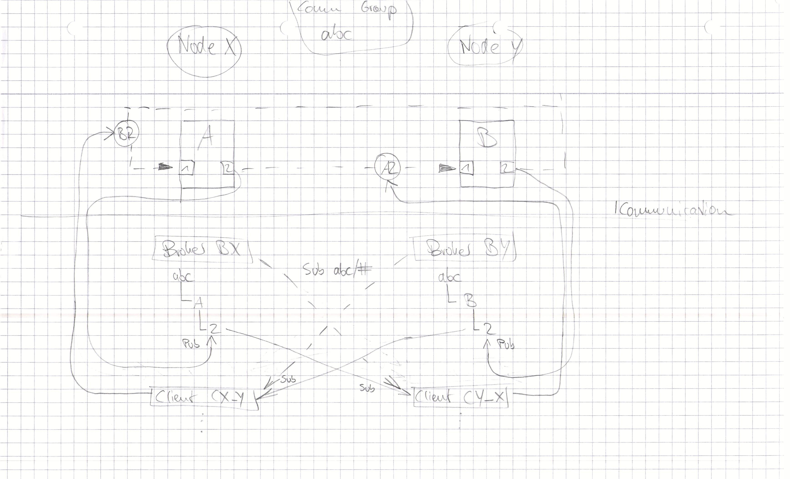
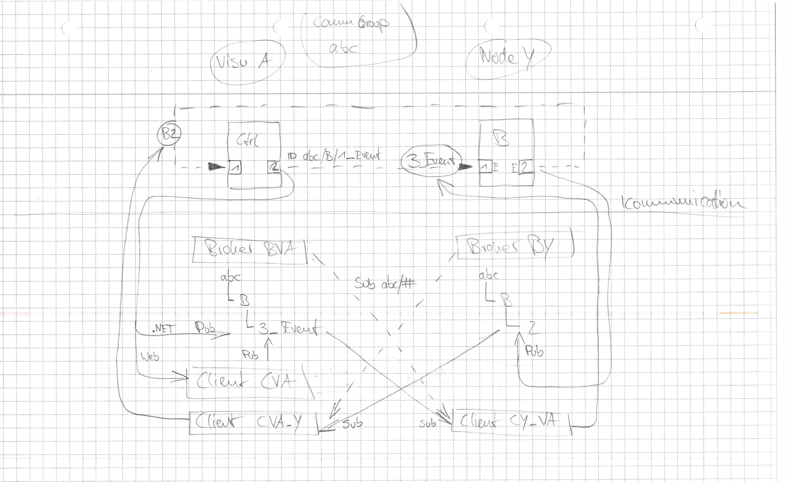

# ViciOne Core

## Projektstruktur

|Projekt|Inhalt|
|-|-|
|`FunctionBlockDesignGenerator`|Kommandozeilen-Tool mit dem die Funktionalität aus `ViciOne.Core.Dataflow.DataModel.Generation` verfügbar gemacht wird|
|`FunctionBlockExecutor`|Kommandozeilen-Tool mit dem die Funktionalität aus `ViciOne.Core.Runtime.Execution` verfügbar gemacht wird|
|`ViciOne.Core.Contracts`|die Vertrags-Definitionen der Kernobjekte sowie grundlegende Objekte, die an verschiedensten Stellen verwendet werden|
|`ViciOne.Core.Dataflow`|alle Objekte die den Dataflow und seine Komponenten darstellen sowie zugehörige Editoren|
|`ViciOne.Core.Dataflow.DataModel.Generation`|Analyzer und Generator um aus einem RuntimeFunctionBlock-Assembly das zugehörige FunctionBlockDesign zu generieren|
|`ViciOne.Core.Runtime`|die Basisklasse, von der alle Funktionsblöcke erben sollen sowie zugehörige Objekte|
|`ViciOne.Core.Runtime.Execution`|Funktionalität um einen FB aus einem RuntimeFunctionBlock-Assembly auszuführen|
|`ViciOne.Engine`|die Runtime um Dataflows auszuführen|
|`ViciOne.Engine.DefaultPoolings`|die Standardimplementierungen der Verrechnungsalgorithmen|
|`ViciOne.Engine.DefaultValidators`|die Standardimplementierungen der Prüfalgorithmen|
|`ViciOne.Serialization.Json`|Methoden zum (De-)Serialisieren von Objekten im JSON-Format|

## Beispiele

### samples/communication/mqtt

Hier ist eine beispielhafte Kommunikation über MQTT nach folgendem Konzept implementiert:

**Hinweis:** Zumindest im .NET braucht der Node zum Publishen keinen Client, er kann direkt über den Broker/Server publishen. Damit fällt in diesem Fall der eingezeichnete Client `CVA` weg.

### samples/communication/zeromq

Eine Beispiel-Implementierung für eine Kommunikation über ZeroMQ, die nach dem selben Konzept arbeitet, wie das MQTT-Beispiel.

### samples/communication/amqp/clientonly

Eine Beispiel-Implementierung für eine Kommunikation über AMQP, die nur die Client-Funktionalität enthält. Damit kann sich zu verschiedenen Brokern verbunden werden.

### samples/communication/amqp/both

Eine Beispiel-Implementierung für eine Kommunikation über AMQP, die nach dem selben Konzept arbeitet, wie das MQTT-Beispiel.

### samples/data-separation

Hier sind verschiedene Möglichkeiten implementiert, um Darstellungs-Informationen getrennt vom eigentlichen Datenmodell abzulegen.

### samples/pooling

Eine Beispiel-Anwendung, welche die Verwendung der Poolings zur Design-Zeit zeigt.

### samples/presentation

Eine Beispiel-Anwendung, mit der ein Dataflow visualisiert werden kann.

### samples/runtime

Eine Beispiel-Anwendung, welche die Verwendung der Engine und ihrer Abhängigkeiten zeigt.

### samples/runtime/fbs

Enthält einige Beispiel-Funktionsblöcke.
